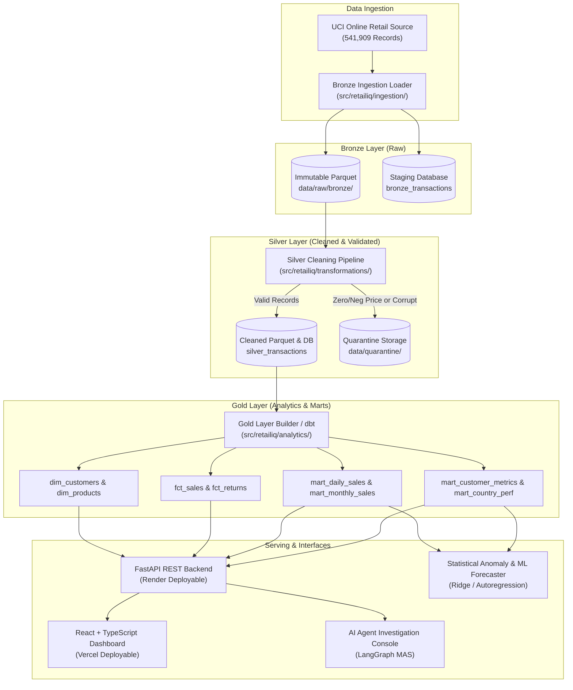
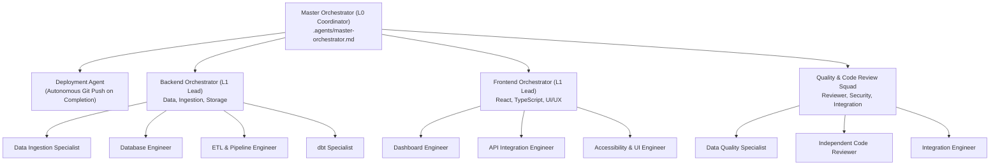

# RetailIQ: AI-Powered E-commerce Data Lakehouse & Multi-Agent Analytics Platform

[](AGENTS.md)
[](#-automated-testing--quality-gates)
[](#-frontend-deployment-vercel)
[](#-backend-deployment-render)
[](configs/dataset_provenance.md)

**RetailIQ** is an enterprise-grade retail intelligence platform that transforms raw transactional order streams into trusted, validated analytics and automated business intelligence. Built upon a disciplined **Bronze–Silver–Gold Data Lakehouse** and governed by a hierarchical **Multi-Agent System (MAS)**, RetailIQ features continuous autonomous Git deployments, deterministic quality invariant auditing, statistical anomaly detection, and ML sales forecasting.

---

## 🏛️ Architecture Overview

### 1. Data Lakehouse Architecture (Medallion Pattern)



### 2. Hierarchical Multi-Agent System (MAS)

RetailIQ's engineering and investigation plane is operated through a multi-agent hierarchy inspired by GitPulse:



---

## 🚀 Cloud Deployment Guides

### 🌐 Frontend Deployment (Vercel)

The frontend is an optimized React 18 + Vite SPA configured for zero-configuration deployment on **Vercel**.

1. Connect your GitHub repository to [Vercel](https://vercel.com).
2. Configure project settings:
   - **Framework Preset**: `Vite`
   - **Root Directory**: `./` (Root)
   - **Build Command**: `npm --prefix frontend install && npm --prefix frontend run build` (configured in [`vercel.json`](vercel.json))
   - **Output Directory**: `frontend/dist`
3. Set optional environment variable:
   - `VITE_API_URL`: URL of your Render backend service (e.g. `https://retailiq-api.onrender.com`).
4. Click **Deploy**. Vercel will build the frontend and serve it with clean URLs and client-side routing rewrites.

### 🐍 Backend Deployment (Render)

The backend is built with FastAPI and is configured for 1-click deployment on **Render** using [`render.yaml`](render.yaml):

1. Connect your repository to [Render](https://render.com).
2. Select **Blueprints** and choose [`render.yaml`](render.yaml) (or create a Web Service pointing to root).
3. Runtime Settings:
   - **Runtime**: `Python 3.11.7`
   - **Build Command**: `pip install --upgrade pip && pip install -r requirements.txt && pip install -e .`
   - **Start Command**: `uvicorn backend.app.main:app --host 0.0.0.0 --port $PORT`
   - **Health Check Path**: `/api/v1/health`
4. The service automatically falls back to self-initializing SQLite storage in free-tier environments or connects to managed PostgreSQL via `DATABASE_URL`.

---

## 💻 Command-Line Interface (CLI)

The lakehouse pipeline can be run entirely via the CLI without external schedulers:

```bash
# Set Python path
$env:PYTHONPATH = "src;."

# 1. Download official UCI Online Retail dataset archive
python -m retailiq.cli download

# 2. Ingest raw records into Bronze Parquet
python -m retailiq.cli ingest --limit 10000

# 3. Clean records, isolate invalid rows to quarantine, and build Gold marts
python -m retailiq.cli transform --layer all --load-db

# 4. Run full end-to-end pipeline in a single command
python -m retailiq.cli run-all --limit 10000

# 5. Inspect batch metadata and lakehouse run history
python -m retailiq.cli status
```

---

## 🤖 Autonomous Git Deployment Agent

Per the mandatory rule in [`AGENTS.md`](AGENTS.md):
> **AFTER EVERY TASK IS FINISHED, PUSH TO GIT IMMEDIATELY.**

The `deployment-agent` programmatically packages, commits, and pushes to `origin main` whenever a task satisfies all quality gates:

```bash
# Trigger automated deployment push
python -m agent_runtime.deployment.auto_deploy --message "feat(scope): completed task" --task-id "TASK-ID"
```

---

## 🧪 Automated Testing & Quality Gates

Run the comprehensive test suite (Unit, Integration, Analytics, Database, API, and Agent Runtime):

```bash
$env:PYTHONPATH = "src;."
python -m pytest tests/unit agent_runtime/tests -v
```

### Verified Test Results (36/36 Passing):
- **Ingestion & Schema Tests**: Deterministic row hashing, batch lifecycle, Snappy Parquet persistence, checksum idempotency (10 tests).
- **Transformation & Quarantine Tests**: Normalization, cancellation flagging, guest checkout preservation, quarantine isolation (3 tests).
- **Gold Layer & Analytics Tests**: Fact sales revenue calculations, returns logic, customer dimensions, daily marts (1 test).
- **Statistical Anomaly & Forecaster Tests**: Rolling deviation spike detection, chronological train/test split, autoregressive projection (2 tests).
- **FastAPI Backend Tests**: Health checks, overview metrics, agent investigation lifecycle (4 tests).
- **Database Persistence Tests**: Connection pooling, SQLite/Postgres compatibility, repository inserts (1 test).
- **Agent Runtime & Deployment Tests**: Task store state machine, file ownership permissions, auto-deployment engine (9 tests).
- **Frontend Build**: `npm --prefix frontend run build` compiles with **0 errors, 0 warnings**.

---

## 📊 Dataset Provenance & Semantic Specifications

- **Dataset**: [UCI Online Retail Dataset](https://archive.ics.uci.edu/dataset/352/online+retail) (Dr. Daqing Chen, London South Bank University).
- **Volume**: 541,909 records covering 01/12/2010 to 09/12/2011.
- **License**: Creative Commons Attribution 4.0 International (CC BY 4.0).
- **Limitations & Real-World Semantics**:
  - `InvoiceNo`: Cancellations are explicitly prefixed with `'C'` and negative quantities; both are segmented into `fct_returns`.
  - `CustomerID`: ~25% of records represent guest checkouts (`CustomerID = NaN`); these are preserved in Silver as `guest_checkout` to maintain accurate revenue totals.
  - `UnitPrice`: Rows with `UnitPrice <= 0.0` (manual write-offs, gifts, damages) are quarantined to prevent report corruption.
  - **No Unit Cost**: The dataset contains selling prices but **no product acquisition cost**. Gross revenue is reported, but profit margins are strictly not fabricated.

---

## 📂 Repository Structure

```
leakehouse/
├── AGENTS.md                  # Master MAS governance manual & Git Push mandate
├── README.md                  # Comprehensive onboarding & architecture guide
├── .gitignore                 # Exclusion rules (raw data & binaries ignored)
├── .env.example               # Environment variables template
├── render.yaml                # Render Blueprint infrastructure specification
├── Procfile                   # Process start command for Python web servers
├── package.json               # Root workspace build script for Vercel
├── vercel.json                # Vercel deployment & rewrite configuration
├── .vercelignore              # Frontend deployment exclusions
├── requirements.txt           # Python backend dependencies
│
├── .agents/                   # Agent Personas, Policies, Workflows & Contracts
│   ├── master-orchestrator.md # L0 Supreme Executive
│   ├── orchestrators/         # L1 Domain leads (backend, frontend)
│   ├── backend/               # L2 Specialized backend engineering personas
│   ├── frontend/              # L2 Specialized frontend engineering personas
│   ├── shared/                # Deployment agent, architect, reviewer, devops
│   ├── policies/              # Coding standards, ownership, quality gates
│   └── tasks/                 # Current ledger, contracts, backlog
│
├── agent_runtime/             # Programmatic Python Orchestration & Deployment Engine
│   ├── deployment/            # Automated Git deployment agent & CLI
│   ├── shared/                # Task store, state machine, permissions
│   ├── tools/                 # Git, filesystem, and test execution tools
│   └── tests/                 # Agent runtime unit tests
│
├── src/retailiq/              # Core RetailIQ Lakehouse & Analytics Source
│   ├── config.py              # Configuration manager
│   ├── cli.py                 # Lakehouse CLI commands
│   ├── ingestion/             # Download, raw validation, batch manager, Bronze loader
│   ├── transformations/       # Silver cleaning, quarantine manager
│   ├── database/              # SQLAlchemy models, connection pools, repositories
│   ├── analytics/             # Gold builder, anomaly detection, sales forecaster
│   ├── pipeline/              # End-to-end runner, quality invariant checker
│   └── agents/                # Master orchestrator, specialists, state, tools
│
├── backend/app/               # FastAPI REST Application (Render deployable)
│   └── main.py                # Health, overview, trends, QA, and agent routes
│
├── frontend/                  # React 18 + TypeScript + Vite SPA (Vercel deployable)
│   ├── src/                   # Executive, Product, Customer, QA, & Agent pages
│   ├── package.json           # Frontend dependencies
│   └── vite.config.ts         # Vite build configuration
│
├── dashboard/                 # Streamlit analytics application (local BI exploration)
├── dbt_retailiq/              # dbt core project, staging views, and mart models
├── airflow/dags/              # Airflow DAG definition for lakehouse orchestration
├── tests/unit/                # 36 automated unit & integration test suites
└── configs/                   # Settings and dataset provenance documentation
```
